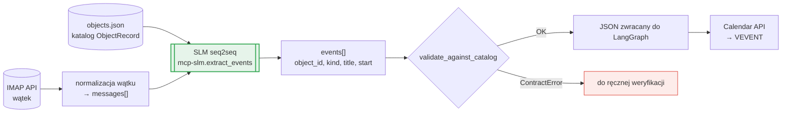

# 00 — SLM: model seq2seq do ekstrakcji zdarzeń z maili

> **Status: POC.** Model jest wytrenowany wyłącznie na **obiektach noclegowych** (hotele, apartamenty, pensjonaty). Kontrakt dla **transferów (taxi)** i **przewodników** nie jest jeszcze zdefiniowany.

Główny element rozwiązania. Model SLM seq2seq dostaje **katalog obiektów** i **wątek mailowy**, a zwraca **listę zdarzeń kalendarzowych** jako JSON. W całym systemie jest wystawiony jako narzędzie przez MCP (`mcp-slm`) i wywoływany przez orkiestrator LangGraph — patrz [01 — Overview](01-overview.md).

## Wyniki

| Zbiór | Liczba wątków mailowych |
|---|---|
| Trening | **800** |
| Ewaluacja | **300** innych wątków, których model nigdy wcześniej „nie widział” |

Każdy wątek ma format opisany niżej. Pełny przykład jest w sekcji [Przykład](#przykład-gen-s1-000300-split-validation). Zbiór ewaluacyjny jest rozłączny z treningowym, więc wyniki pokazują, jak model radzi sobie z nowymi wątkami, a nie jak dobrze zapamiętał dane treningowe.

| Metryka | Wynik |
|---|---|
| Calendar match | **95.37%** |
| Event F1 | **95.55%** |
| Poprawny JSON | **100%** |
| Latencja — mediana | **2.80 s** |
| Latencja — P90 | **5.28 s** |

- **Event F1** porównuje przewidziane zdarzenia z oczekiwanymi. Tytuł (`title`) nie jest brany pod uwagę, bo wiele tytułów jest równie dobrych.
- **Poprawny JSON 100%** oznacza, że każdą odpowiedź modelu da się sparsować, więc warstwa nad modelem nie potrzebuje logiki naprawiania outputu.
- **Latencja** dotyczy jednego wątku. Przy przetwarzaniu wielu wątków (np. całego miesiąca poczty) orkiestrator może wywoływać model równolegle.

## Przepływ danych



## Typy kontraktu (`SCHEMA_VERSION = 1`)

Wszystkie typy to niezmienne (frozen) dataclassy, które sprawdzają swoje reguły przy tworzeniu. Naruszenie reguły zgłasza `ContractError` ze ścieżką pola, np. `messages[1].subject: must not be empty`. Pliki zapisane w innej wersji schematu są odrzucane.

### `ObjectRecord` — katalog obiektów (`objects.json`)

Katalog jest **częścią inputu modelu przy każdym wywołaniu**. Dzięki temu model zamienia dowolną nazwę użytą w mailu („Senior”, „ta willa nad morzem”) na stały `id`.

| Pole | Typ | Reguły |
|---|---|---|
| `id` | slug | `^[a-z0-9]+(-[a-z0-9]+)*$`, unikalny w katalogu, np. `pensjonat-pod-lipami` |
| `name` | string | oficjalna nazwa, np. „Pensjonat Pod Lipami” |
| `aliases` | string[] | potoczne nazwy z maili, może być puste |

### `Message` — input modelu (`messages[]`)

| Pole | Typ | Reguły |
|---|---|---|
| `id` | string | bez spacji, unikalny w wątku, konwencja `<conversation_id>-m<n>` |
| `sender` | string | adres nadawcy |
| `sent_at` | ISO 8601 **z offsetem** | punkt odniesienia dla dat względnych („jutro”, „2.04”) |
| `subject` | string | niepusty, odpowiedzi zwykle z prefiksem `Re: ` |
| `body` | string | czysty tekst bez cytatów wcześniejszych wiadomości |

Wiadomości w wątku są uporządkowane chronologicznie według `sent_at`, a wątek ma co najmniej jedną wiadomość.

### `CalendarEvent` — output modelu (`events[]`, w zbiorze danych `expected_events`)

Jedno zdarzenie dotyczy **jednego dnia**. Pobyt od 30.03 do 3.04 to dwa zdarzenia: `check_in` i `check_out`.

| Pole | Typ | Reguły |
|---|---|---|
| `object_id` | slug | musi istnieć w katalogu (`validate_against_catalog`) |
| `kind` | `EventKind` | jedna z wartości poniżej |
| `title` | string | tytuł po polsku; nie jest brany pod uwagę przy ocenie modelu, bo wiele tytułów jest równie dobrych |
| `start` | `YYYY-MM-DD` | data bez godziny, daty względne już przeliczone |

| `EventKind` | Znaczenie |
|---|---|
| `check_in` | zameldowanie, początek pobytu |
| `check_out` | wymeldowanie, koniec pobytu |
| `reservation_change` | przesunięcie rezerwacji; `start` to **nowa** data |
| `other` | inne zdarzenie z datą dotyczące obiektu, np. przegląd przeciwpożarowy, serwis, szkolenie |

### `Conversation` — przykład treningowy (linia `conversations.jsonl`)

`id`, `messages[]`, `expected_events[]`, `split` (`train` ≈ 80% / `validation` ≈ 10% / `test` ≈ 10%, przypisany raz na stałe) oraz `metadata`. Pole `metadata` opisuje pochodzenie przykładu i **nigdy nie jest pokazywane modelowi**. Wątek bez zdarzeń (np. faktura albo ogólne pytanie) to poprawny i ważny przykład negatywny.

## Narzędzia MCP wystawiane przez `mcp-slm`

| Tool | Opis |
|---|---|
| `extract_events(messages[])` | inferencja SLM z aktualnym katalogiem → `events[]` po walidacji kontraktu |
| `resolve_object(name)` | zamienia nazwę lub alias (np. „Senior”, „Senior Krakow”) na `object_id` z katalogu |
| `get_catalog()` | zwraca katalog obiektów |

Katalog jest trzymany po stronie serwera `mcp-slm`, bo jest nierozerwalną częścią inputu modelu.

## Mapowanie na kalendarz

| events[] | iCalendar VEVENT |
|---|---|
| `title` | `SUMMARY` |
| `start` | `DTSTART;VALUE=DATE` (zdarzenie całodniowe) |
| `object_id` → `ObjectRecord.name` | `LOCATION` |
| `kind` | `CATEGORIES` |
| id wątku + `object_id` + `kind` | `UID` — klucz idempotencji: ponowny sync aktualizuje, nie duplikuje |

`reservation_change` nie tworzy nowego wpisu, tylko przesuwa istniejący wpis tego obiektu z tego wątku. Agent rozstrzyga, który to wpis. W POC przyjmujemy, że jest to `check_in`.

## Przykład: `gen-s1-000300` (split: validation)

Co pokazuje ten przypadek (`metadata.traits`):

- **Nie każda wiadomość niesie decyzję.** m1 i m2 to zapytanie i potwierdzenie dostępności, więc nie dają żadnego zdarzenia.
- **Zdarzenie w odpowiedzi** (`event_in_reply`): decyzje padają dopiero w m3 i m4.
- **Wiele obiektów w jednym wątku** (`multi_object`): wątek dotyczy Pensjonatu Pod Lipami, ale m3 mimochodem podaje wymeldowanie z Apartamentów Nadmorskie. Model rozpoznaje oba obiekty dzięki katalogowi.
- **Daty bez roku** (`date:numeric_no_year` „2.04”, `date:text_no_year` „30 marca”): model wylicza rok 2027 z `sent_at` (grudzień 2026), czyli najbliższe przyszłe wystąpienie daty.
- **Wiele zdarzeń** (`multi_event`): 3 zdarzenia z jednego wątku.

```json
{
  "schema_version": 1,
  "id": "gen-s1-000300",
  "split": "validation",
  "messages": [
    {
      "id": "gen-s1-000300-m1",
      "sender": "tomasz.wojcik@biuro-podrozy.example",
      "sent_at": "2026-12-26T12:00:00+01:00",
      "subject": "Grupa firmowa z Poznania - ustalenie pobytu",
      "body": "Dzień dobry, piszę w sprawie grupy firmowej z Poznania, dla której koordynuję pobyt w Pensjonacie Pod Lipami. Proszę o potwierdzenie dostępności miejsc oraz warunków zakwaterowania dla tej grupy. Będę wdzięczny za szybką odpowiedź, ponieważ klient czeka na potwierdzenie. Pozdrawiam, Tomasz Wójcik."
    },
    {
      "id": "gen-s1-000300-m2",
      "sender": "recepcja@pensjonat-pod-lipami.example",
      "sent_at": "2026-12-27T02:58:00+01:00",
      "subject": "Re: Grupa firmowa z Poznania - ustalenie pobytu",
      "body": "Dzień dobry, potwierdzamy dostępność miejsc dla grupy firmowej z Poznania w Pensjonacie Pod Lipami. Prosimy o przesłanie ostatecznej liczby uczestników oraz szczegółów dotyczących wyżywienia. Czekamy na dalsze informacje. Pozdrawiamy, Recepcja Pensjonatu Pod Lipami."
    },
    {
      "id": "gen-s1-000300-m3",
      "sender": "tomasz.wojcik@biuro-podrozy.example",
      "sent_at": "2026-12-27T03:43:00+01:00",
      "subject": "Re: Grupa firmowa z Poznania - ustalenie pobytu",
      "body": "Dzień dobry, w międzyczasie chciałbym poinformować, że grupa kończy swój pobyt w Apartamentach Nadmorskie i ma wymeldowanie zaplanowane na 2.04. Proszę o uwzględnienie tego terminu przy planowaniu kolejnego etapu podróży grupy. Dziękuję za pomoc w koordynacji. Pozdrawiam, Tomasz Wójcik."
    },
    {
      "id": "gen-s1-000300-m4",
      "sender": "recepcja@pensjonat-pod-lipami.example",
      "sent_at": "2026-12-28T12:29:00+01:00",
      "subject": "Re: Grupa firmowa z Poznania - ustalenie pobytu",
      "body": "Dzień dobry, potwierdzamy, że grupa firmowa z Poznania zostanie zameldowana w Pensjonacie Pod Lipami z przyjazdem na 30 marca. Wymeldowanie z Pensjonatu Pod Lipami zaplanowane jest na 3 kwietnia. Wszystkie pokoje są już przygotowane zgodnie z ustaleniami. Pozdrawiamy, Recepcja Pensjonatu Pod Lipami."
    }
  ],
  "expected_events": [
    {
      "object_id": "apartamenty-nadmorskie",
      "kind": "check_out",
      "title": "Wymeldowanie grupy z Apartamentów Nadmorskie",
      "start": "2027-04-02"
    },
    {
      "object_id": "pensjonat-pod-lipami",
      "kind": "check_in",
      "title": "Zameldowanie grupy w Pensjonacie Pod Lipami",
      "start": "2027-03-30"
    },
    {
      "object_id": "pensjonat-pod-lipami",
      "kind": "check_out",
      "title": "Wymeldowanie grupy z Pensjonatu Pod Lipami",
      "start": "2027-04-03"
    }
  ],
  "metadata": {
    "source": "calendar-event-dataset-generator",
    "scenario_id": "gen-s1-000300",
    "seed": 1,
    "planner_version": 2,
    "render_prompt_version": 3,
    "render_model": "claude-sonnet-5",
    "verify_version": 1,
    "verify_model": null,
    "traits": [
      "date:numeric_no_year",
      "date:text_no_year",
      "event_in_reply",
      "kind:check_in",
      "kind:check_out",
      "multi_event",
      "multi_object",
      "thread"
    ],
    "run_name": "train-1000"
  }
}
```

## Poza zakresem POC

| Obszar | Stan |
|---|---|
| Obiekty noclegowe (hotel, apartament, pensjonat) | ✅ zdefiniowane i wytrenowane |
| Transfery (taxi, bus wieloosobowy) | ⏳ brak kontraktu: typ obiektu, `EventKind` (np. odbiór / przejazd), godzina zamiast samej daty |
| Przewodnicy (tour guide) | ⏳ brak kontraktu: typ obiektu, `EventKind`, przedział czasu |
| Godziny zdarzeń | ⏳ `start` to sama data; transfery i przewodnicy będą wymagać godziny, czyli zmiany schematu i podbicia `SCHEMA_VERSION` |
| Prawdziwe skrzynki | ⏳ obecnie wyłącznie dane z generatora (`calendar-event-dataset-generator`) |
