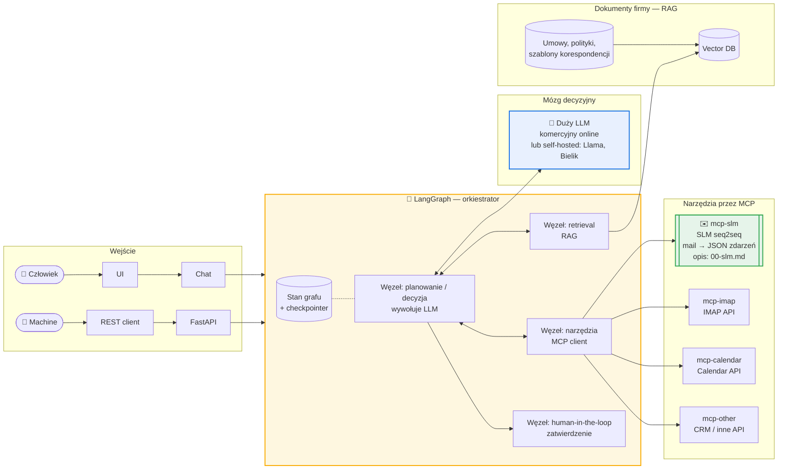
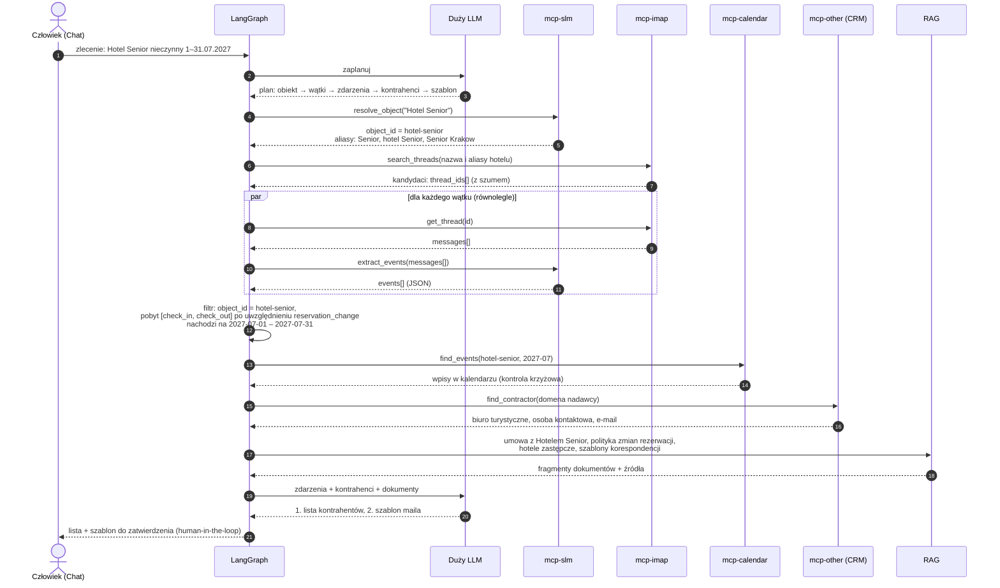

# 01 — Overview rozwiązania

Centralnym punktem jest **LangGraph**, czyli orkiestrator agenta. Z jednej strony przyjmuje zlecenia od człowieka (chat) i od maszyn (REST). Z drugiej strony korzysta z dużego LLM jako mózgu decyzyjnego, z modelu SLM jako narzędzia MCP, z innych narzędzi MCP oraz z dokumentów firmy przez RAG.

## Architektura

| Element | Rola |
|---|---|
| **Chat (UI)** | rozmowa z człowiekiem, wyniki i prośby o zatwierdzenie |
| **FastAPI** | to samo zlecenie wywołane przez system zewnętrzny, np. CRM albo harmonogram zadań |
| **LangGraph** | stan rozmowy, pętla „decyzja → narzędzie → obserwacja”, retrieval, przerwanie na zatwierdzenie przez człowieka |
| **Duży LLM** | mózg decyzyjny: planuje kroki, wybiera narzędzia, łączy wyniki, pisze teksty |
| **mcp-slm** | specjalistyczne narzędzie: wątek mailowy → zdarzenia (`object_id`, `kind`, `start`) w JSON, szybko i lokalnie ([00](00-slm.md)) |
| **mcp-imap / mcp-calendar / mcp-other** | dostęp do skrzynki, kalendarza i pozostałych systemów firmy (np. CRM z danymi kontrahentów) |
| **RAG** | wiedza z dokumentów firmy: umowy z hotelami, polityka zmian rezerwacji, szablony i ton korespondencji |

**Podział pracy LLM ↔ SLM.** Duży LLM nie czyta setek wątków mailowych. Robi to SLM, lokalnie i z 100% poprawnego JSON-u. LLM dostaje już ustrukturyzowane zdarzenia. Jest to tańsze i szybsze, a przy LLM komercyjnym online treść maili nie opuszcza firmy, bo do LLM trafiają tylko wyniki ekstrakcji. Self-hosted model (Llama, Bielik) eliminuje ten problem całkowicie, kosztem utrzymania infrastruktury.

## Scenariusz: Hotel Senior nieczynny w lipcu 2027

**Zlecenie:** „Hotel Senior będzie nieczynny od 1 do 31 lipca 2027. Które biura turystyczne mają tam **potwierdzony** pobyt grupy nachodzący na ten okres?
1. Przygotuj listę kontrahentów.
2. Przygotuj szablon maila informującego kontrahenta o zmianie hotelu.”

Na to zlecenie nie da się odpowiedzieć wyszukiwaniem po słowach kluczowych. Odpowiedź wymaga zrozumienia treści wątków, czyli tego, czego nauczył się SLM:

| Wymaganie w zleceniu | Dlaczego wyszukiwanie nie wystarczy | Co robi SLM |
|---|---|---|
| **„potwierdzony”** | zapytanie o dostępność też zawiera nazwę hotelu | odróżnia decyzję od pytania; zapytanie nie daje żadnego zdarzenia |
| **„nachodzący na okres”** | grupa z zameldowaniem 28 czerwca i wymeldowaniem 3 lipca nie ma w mailu słowa „lipiec” | zwraca `check_in` i `check_out` z pełnymi datami, więc zakresy da się przeciąć |
| **daty bez roku** | „2.07” czy „30 czerwca” nie zawierają „2027” | wylicza rok z daty wysłania maila (`sent_at`) |
| **zmiany rezerwacji** | wątek „przenosimy pobyt z lipca na sierpień” zawiera nazwę hotelu i „lipiec”, a grupy nie dotyczy | `reservation_change` z nową datą, więc grupa wypada z listy |
| **potoczne nazwy** | ktoś pisze „Senior”, „hotel Senior” albo „Senior Krakow”, a słowo „senior” pada też w „wycieczka seniorów” | katalog z aliasami zamienia nazwę na `hotel-senior`; wzmianka o seniorach nie daje zdarzenia |

**Przykładowy lejek.** IMAP zwraca np. 12 wątków ze słowem „Senior”. Po ekstrakcji przez SLM tylko 5 trafia na listę. Pozostałe odpadają, bo:

| Wątek | Wynik SLM | Powód odrzucenia |
|---|---|---|
| zapytanie o dostępność bez odpowiedzi | brak zdarzeń | brak decyzji |
| „przenosimy pobyt z 10.07 na 14 sierpnia” | `reservation_change` → 2027-08-14 | po zmianie pobyt poza lipcem |
| pobyt 2–6 czerwca | `check_in` 2027-06-02, `check_out` 2027-06-06 | brak nakładania na lipiec |
| wątek o Pensjonacie Pod Lipami, Senior wspomniany mimochodem | zdarzenia z `object_id` = `pensjonat-pod-lipami` | inny obiekt |
| „wycieczka seniorów do Zakopanego” | brak zdarzeń dla `hotel-senior` | „senior” to nie nazwa hotelu |
| … | | |

Natomiast grupa z pobytem 28.06–3.07 **trafia** na listę, choć w jej wątku nie pada słowo „lipiec”.

### Wynik 1: lista kontrahentów (format)

| Biuro turystyczne | Osoba kontaktowa | E-mail | Grupa | Zameldowanie | Wymeldowanie | Wątek źródłowy |
|---|---|---|---|---|---|---|
| *z CRM* | *z CRM* | *nadawca z wątku* | *z wątku* | `check_in.start` | `check_out.start` | `thread_id` |

Kolumny dat pochodzą bezpośrednio z outputu SLM. Każdy wiersz linkuje do wątku źródłowego, więc człowiek może zweryfikować wynik.

### Wynik 2: szablon maila (przykład)

> **Temat:** Zmiana hotelu dla grupy {{grupa}} — {{data_od}}–{{data_do}}
>
> Dzień dobry {{osoba_kontaktowa}},
>
> uprzejmie informujemy, że Hotel Senior będzie nieczynny od 1 do 31 lipca 2027 r. Dotyczy to rezerwacji dla grupy {{grupa}} w terminie {{data_od}}–{{data_do}}, ustalonej w naszej korespondencji z dnia {{data_ustalenia}}.
>
> Proponujemy zakwaterowanie w {{hotel_zastępczy}} w niezmienionym terminie, na warunkach {{warunki_zgodnie_z_umową}}. Prosimy o potwierdzenie do {{termin_odpowiedzi}}.
>
> Przepraszamy za utrudnienia i pozostajemy do dyspozycji.
>
> Z poważaniem,
> {{podpis}}

Placeholdery wypełnia LLM: dane kontrahenta pochodzą z CRM, terminy z SLM, a hotel zastępczy i warunki z RAG. Wysłanie maili nie należy do scenariusza. Agent przygotowuje szablon i listę, a decyzję o wysyłce podejmuje człowiek.
